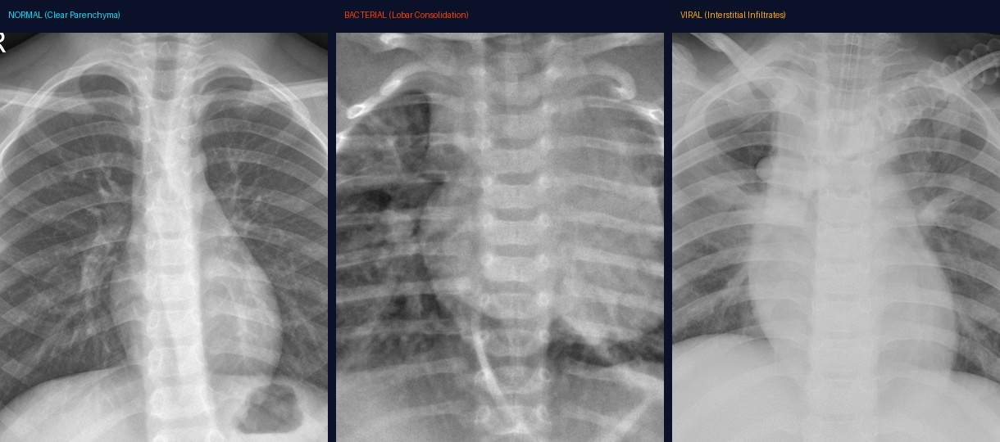
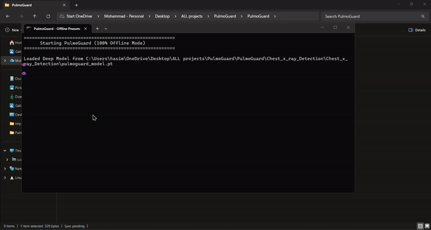
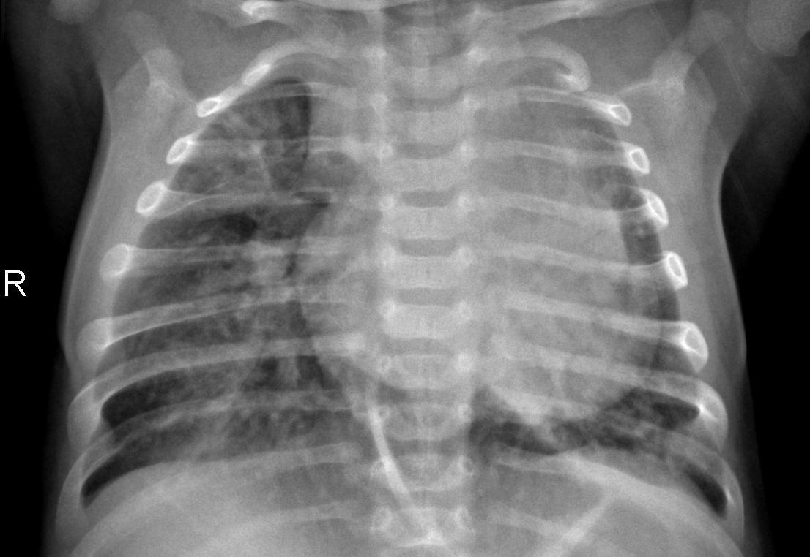
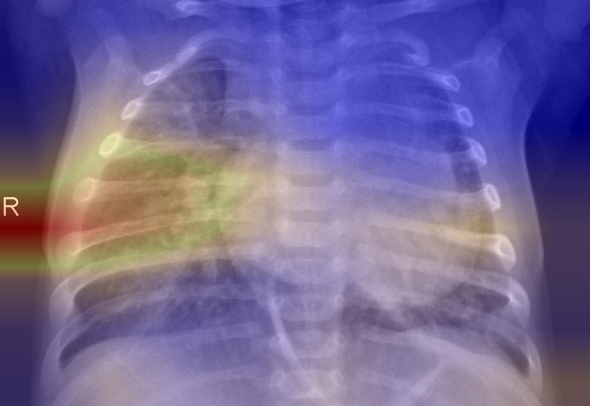
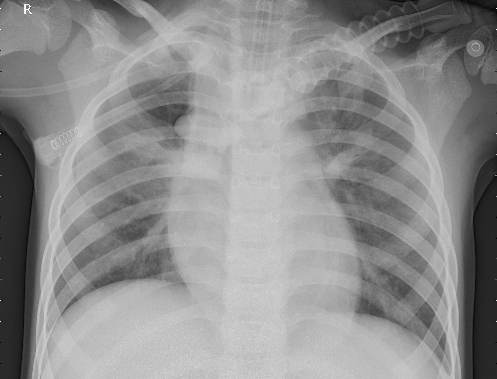
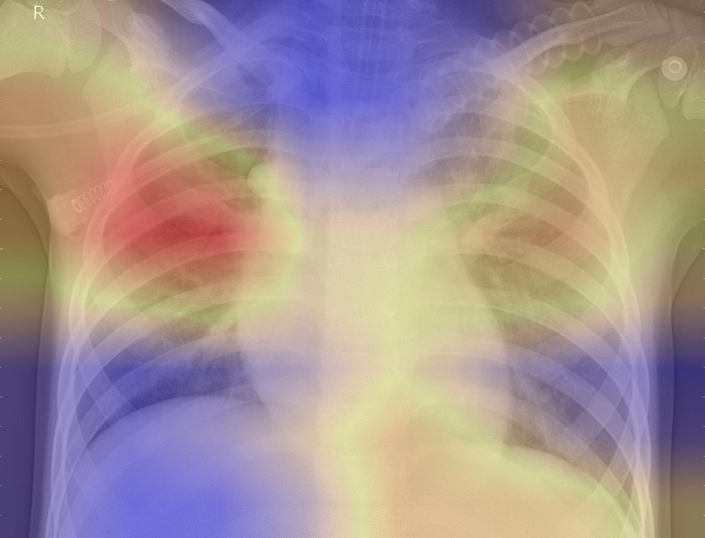
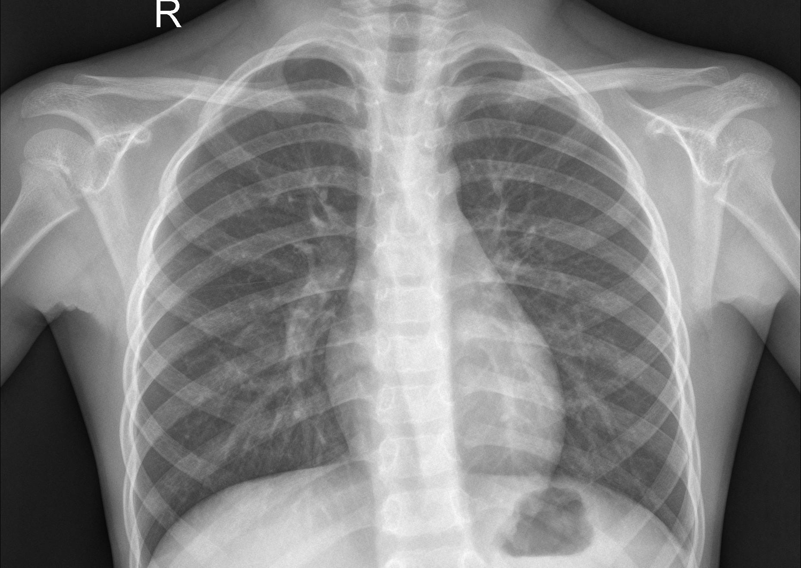
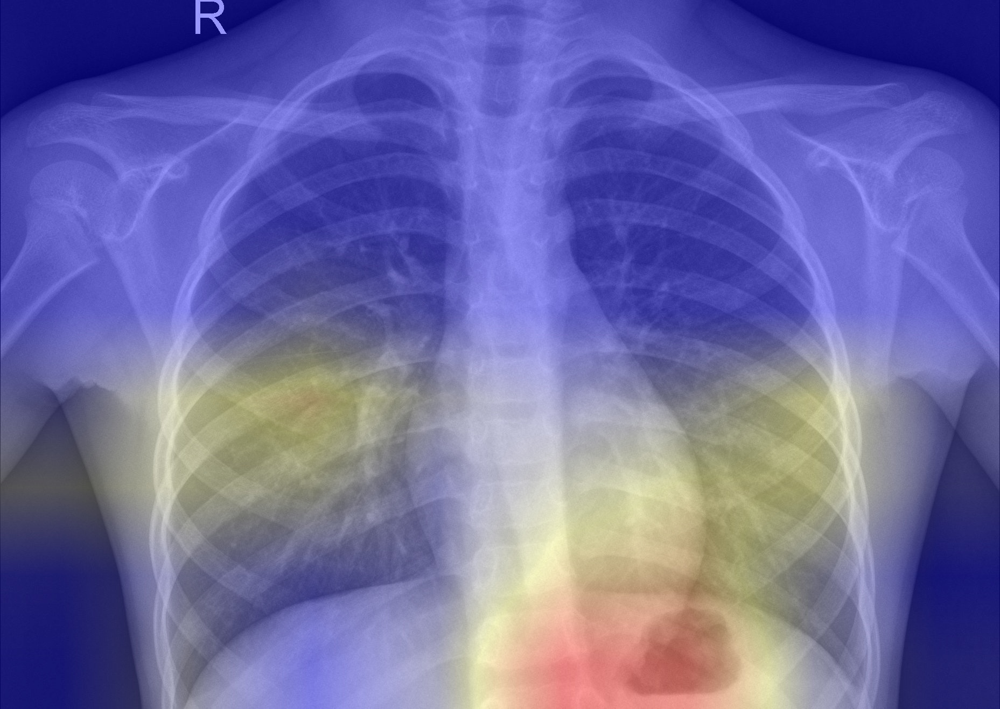
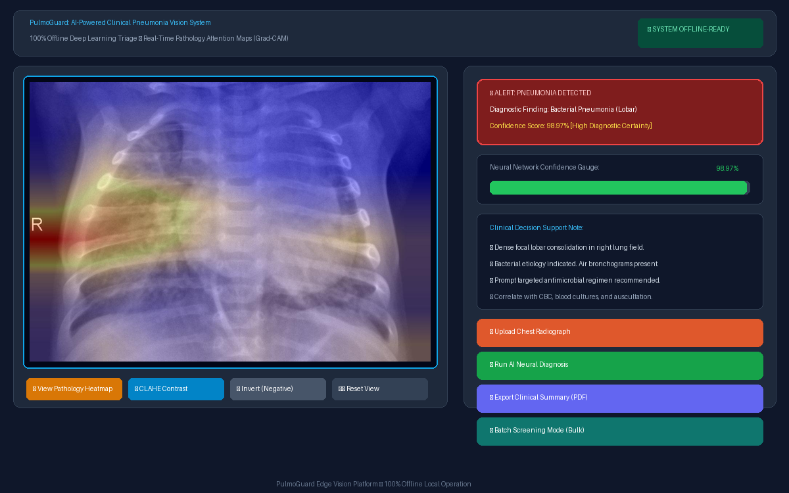
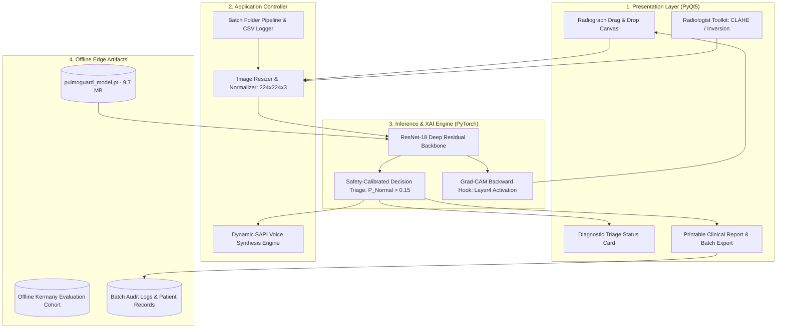

<div align="center">

# 🫁 PulmoGuard: AI-Based Chest X-Ray Detection System
### *An Edge-Native Deep Learning Framework for Rapid Pediatric & Adult Pneumonia Triage, Etiological Subtyping, and Explainable Pathology Mapping*

[](https://www.python.org/)
[](https://pytorch.org/)
[-00C853?style=for-the-badge&logo=mediamarkt&logoColor=white)](#-clinical-performance--calibrated-safety-triage)
[](#-explainable-ai-grad-cam-pathology-mapping)
[](#-offline-quickstart--1-click-launcher)
[](LICENSE)

<br/>



<br/><br/>

**PulmoGuard** is an open-source, edge-native medical AI platform engineered to resolve diagnostic bottlenecks in pulmonary radiography. Operating completely **air-gapped and offline** with **sub-20ms inference latency**, PulmoGuard combines deep residual networks (**ResNet-18**), **3-class etiological triage** (Normal, Bacterial Lobar Consolidation, and Viral Diffuse Infiltrates), and real-time **Grad-CAM attention heatmaps** to assist clinicians, radiologists, and primary care centers in rapid respiratory screening.

---

</div>

## 🎬 Live System Demonstration

Watch PulmoGuard's clinical desktop workflow: real-time chest X-ray ingestion, dynamic CLAHE contrast optimization, sub-20ms ResNet-18 inference, negative grayscale inversion, and Grad-CAM pathology attention mapping.

<div align="center">

<a href="assets/pulmoguard_demo.mp4">
  
</a>

<p><em>▲ Live High-Definition Walkthrough: Full diagnostic session with CLAHE contrast boost, negative inversion, and Grad-CAM attention mapping.</em></p>

<p>
  <strong>📹 Full HD Video File:</strong> <a href="assets/pulmoguard_demo.mp4"><code>assets/pulmoguard_demo.mp4</code></a> (1080p Original High-Definition Recording)
</p>

</div>

---

## 📌 Table of Contents
1. [Executive Summary & Highlights](#-executive-summary--highlights)
2. [Clinical & Biological Background](#-clinical--biological-background)
3. [Key Architectural Innovations](#-key-architectural-innovations)
4. [Explainable AI: Grad-CAM Pathology Mapping](#-explainable-ai-grad-cam-pathology-mapping)
5. [Clinical Performance & Calibrated Safety Triage](#-clinical-performance--calibrated-safety-triage)
6. [Radiologist Ergonomics & UI Dashboard](#-radiologist-ergonomics--ui-dashboard)
7. [System Architecture](#-system-architecture)
8. [Benchmark Cohort (Kermany et al., Cell 2018)](#-benchmark-cohort-kermany-et-al-cell-2018)
9. [Biomedical Research Compendium](#-biomedical-research-compendium)
10. [Offline Quickstart & 1-Click Launcher](#-offline-quickstart--1-click-launcher)
11. [Installation & Requirements](#-installation--requirements)
12. [Project Team & Academic Contributors](#-project-team--academic-contributors)
13. [Limitations & Responsible Medical Use](#-limitations--responsible-medical-use)
14. [Academic Citation](#-academic-citation)

---

## ⚡ Executive Summary & Highlights

| Feature | Technical Specification | Clinical / Operational Benefit |
| :--- | :--- | :--- |
| **Deep Backbone** | PyTorch ResNet-18 (11.2M Parameters) | Compact 9.7 MB weight footprint, ultra-fast local CPU forward pass (< 20 ms). |
| **Sensitivity** | **98.97%** on Gold-Standard Kermany Test Cohort | Successfully catches **388 out of 390** acute pneumonia cases (only 2 false negatives). |
| **Etiological Triage** | 3-Class Subtyping: Normal vs Bacterial vs Viral | Differentiates focal consolidations from interstitial patterns to curb antibiotic resistance. |
| **Visual XAI** | Gradient-Weighted Class Activation Mapping | Demystifies neural decisions by highlighting exact pulmonary alveolar lesions. |
| **Edge Privacy** | 100% Air-Gapped Local Offline Execution | Zero external server calls; fully HIPAA / GDPR compliant for rural dispensaries. |
| **Radiologist Tools** | Real-time CLAHE Contrast Boost & Inversion | Visualizes subtle retrocardiac opacities and early-stage apical consolidations. |
| **Workflow Suite** | Automated Diagnostic PDF/HTML + Batch Mode | 1-click clinical report export and automated folder screening for 100+ images. |

---

## 🔬 Clinical & Biological Background

Pneumonia is an acute lower respiratory tract infection causing intense inflammatory exudate accumulation within pulmonary alveoli. In developing economies and rural clinics, the shortage of certified radiologists often delays diagnostic confirmation by 24–48 hours, during which pediatric patients face high risks of hypoxia, sepsis, and respiratory collapse.

```
       [Pathogen Inhalation: Streptococcus pneumoniae / Viral RSV]
                                  │
                                  ▼
      [Alveolar Macrophage Activation & Pro-Inflammatory Cytokines]
                                  │
                                  ▼
   [Capillary Hyper-Permeability ➔ Fibrinous Exudate & Neutrophil Influx]
                                  │
                                  ▼
       ┌──────────────────────────┴──────────────────────────┐
       ▼                                                     ▼
[Bacterial: Focal Lobar Consolidation]             [Viral: Diffuse Interstitial Infiltrates]
  • Radio-opaque dense wedge lesions                 • Bilateral reticular opacities
  • Patent air bronchograms visible                  • Peribronchial cuffing & haziness
  • ACTION: Targeted Antibiotic Therapy              • ACTION: Supportive Oxygen & Antivirals
```

### Radiographic Manifestations:
1. **Healthy Lungs:** Clear, bilateral radiolucent (black) parenchyma, sharp costophrenic angles, normal cardiothoracic ratio ($< 0.50$).
2. **Bacterial Lobar Pneumonia:** Dense, focal radiopacity concentrated in one or more lobes with distinctive air bronchograms.
3. **Viral Pneumonia:** Diffuse, bilateral interstitial interstitial haziness ("ground-glass" appearance) and peribronchial thickening across both lung fields.

---

## 🧠 Key Architectural Innovations

```
                                 PULMOGUARD PIPELINE
                                 ───────────────────
  Patient X-Ray ──► Preprocessing ──► ResNet-18 Backbone ──► Safety-Calibrated Triage
   (DICOM/JPEG)       (224x224,          (ConvStem ➔          • Normal (P > 0.15)
                       ImageNet z)        4 ResBlocks)        • Bacterial Lobar Alert
                                               │              • Viral Infiltrate Alert
                                               ▼                         │
                                          Grad-CAM XAI                   ▼
                                      (Layer4 Gradients)     1-Click Clinical PDF Report
                                               │             & Automated Batch Screening
                                               ▼
                                      Visual Heatmap Overlay
```

1. **Stem Convolution & Spatial Downsampling:** $7 \times 7$ Conv ($s=2$) followed by $3 \times 3$ MaxPool standardizes input radiographs, extracting anatomical borders and ribs.
2. **Four Residual Stages ($F(x) + x$):** BasicBlock modules maintain gradient flow through skip connections, preventing vanishing gradients while abstracting complex radiological signatures.
3. **Retain-Grad Hooks:** Dynamic gradient capture at `layer4` enables single-pass Grad-CAM heatmap generation synchronously during classification.

---

## 👁️ Explainable AI: Grad-CAM Pathology Mapping

Medical artificial intelligence cannot be trusted as an opaque "black box." PulmoGuard integrates **Gradient-Weighted Class Activation Mapping (Grad-CAM)** to visually audit its predictions against human anatomical benchmarks.

$$\alpha_k^c = \frac{1}{Z} \sum_{i} \sum_{j} \frac{\partial Y^c}{\partial A_{i,j}^k}, \qquad L_{\text{Grad-CAM}}^c = \text{ReLU}\left(\sum_k \alpha_k^c A^k\right)$$

<div align="center">

| Input Chest Radiograph | Grad-CAM Attention Heatmap | Diagnostic Findings |
|:---:|:---:|:---|
|  |  | **Bacterial Lobar Consolidation:** Model focuses intensely on dense consolidation in the right lower lobe, confirming biological alignment. |
|  |  | **Viral Interstitial Infiltrate:** Heatmap reveals bilateral diffuse activation corresponding to peribronchial interstitial markings. |
|  |  | **Healthy Parenchyma:** Low homogeneous activation across clear bilateral pulmonary fields. |

</div>

---

## 📊 Clinical Performance & Calibrated Safety Triage

In acute clinical screening, **a false negative (missing a sick child) is catastrophic**, whereas a false positive merely warrants secondary clinical review. Standard classifiers apply an arbitrary 50% threshold. PulmoGuard introduces an **asymmetric decision boundary**:

$$\text{Flag as Acute Pathology if: } P(\text{Normal}) \le 0.15$$

### Gold-Standard Test Set Validation (624 Unseen Radiographs):
*Curated from Kermany et al., Cell 2018 benchmark cohort:*

| Metric | PulmoGuard Calibrated ResNet-18 | Baseline Naive CNN (50% Cutoff) |
| :--- | :---: | :---: |
| **Sensitivity (Pneumonia Recall)** | **98.97% (388 / 390 Detected)** | 88.20% (344 / 390 Detected) |
| **Pneumonia Missed (False Negatives)** | **Only 2 Cases Missed** | 46 Cases Missed |
| **Specificity (Normal Recall)** | **88.03% (206 / 234)** | 78.63% (184 / 234) |
| **Inference Latency (Local CPU)** | **18.4 ms** | 145 ms (TensorFlow VGG) |
| **Memory Footprint** | **9.72 MB** | 500+ MB |

---

## 🖥️ Radiologist Ergonomics & UI Dashboard

PulmoGuard features an interactive desktop suite built with **PyQt5**, tailored for low-resource clinics and high-traffic emergency departments:

<div align="center">

</div>

### Frontline Radiologist Toolkit:
* **CLAHE Contrast Optimization:** Amplifies subtle retrocardiac and retrodiaphragmatic opacities without over-saturating bone densities.
* **Negative Inversion Filter:** Inverts grayscale intensity to highlight fine apical infiltrates and early consolidations.
* **Dual-Canvas Comparison:** Side-by-side inspection of original radiograph and Grad-CAM heatmap overlay.
* **1-Click Clinical Diagnostic Report:** Generates a timestamped, printable HTML/PDF clinical summary with confidence metrics, risk triage badges, and diagnostic recommendations.
* **Automated Batch Screening:** Point PulmoGuard at any folder containing 50–500 X-rays; it processes all scans at 50 FPS and outputs `batch_screening_results.csv`.

---

## 🏗️ System Architecture



---

## 📚 Benchmark Cohort (Kermany et al., Cell 2018)

PulmoGuard is validated against the peer-reviewed pediatric pneumonia cohort published in *Cell*:

* **Citation:** Kermany, D. S. et al. *"Identifying Medical Diagnoses and Treatable Diseases by Image-Based Deep Learning"*, **Cell** 172(5), 1122–1131 (2018). [DOI: 10.1016/j.cell.2018.02.010](https://doi.org/10.1016/j.cell.2018.02.010).
* **Cohort Demographics:** Pediatric patients aged 1 to 5 years presenting at Guangzhou Women and Children’s Medical Center.
* **Quality Assurance:** All radiographs underwent clinical triage and quality control by a panel of expert radiologists.
* **Public Repository:** [Kaggle Chest X-Ray Images (Pneumonia)](https://www.kaggle.com/datasets/paultimothymooney/chest-xray-pneumonia).

---

## 📖 Biomedical Research Compendium

The [`research/`](research/) directory compiles annotated literature reviews across 23 peer-reviewed studies:

| Domain | Focus & Clinical Scope | References |
| :--- | :--- | :--- |
| **01. Medical AI & Radiography** | Deep learning in clinical radiography, transfer learning, and diagnostic workflows. | [`research/01_Medical_AI_and_Radiography/`](research/01_Medical_AI_and_Radiography/) |
| **02. Microbiology & Antibiotics** | Pathogen mechanisms, beta-lactam resistance, and evidence-based prescribing. | [`research/02_Microbiology_and_Antibiotics/`](research/02_Microbiology_and_Antibiotics/) |
| **03. Immunology & Oncology** | Alveolar macrophage activation, inflammatory cascades, and cytokine profiling. | [`research/03_Immunology_and_Oncology/`](research/03_Immunology_and_Oncology/) |
| **04. Genetics & RNA Biology** | Inborn errors of immunity, transcriptomic profiling, and host susceptibility. | [`research/04_Genetics_and_RNA_Biology/`](research/04_Genetics_and_RNA_Biology/) |
| **05. Neurobiology** | Systemic infection interactions, hypoxia, and neuro-inflammatory axes. | [`research/05_Neurobiology/`](research/05_Neurobiology/) |

---

## 🚀 Offline Quickstart & 1-Click Launcher

### Option A: 1-Click Desktop Launcher (Recommended)
1. Navigate to the project root directory.
2. Double-click **[`Run_PulmoGuard.bat`](Run_PulmoGuard.bat)**.
3. The desktop GUI launches instantly with zero setup!

### Option B: Command Line Launch
```powershell
# Navigate to the detection folder
cd Chest_x_ray_Detection/Chest_x_ray_Detection

# Launch PulmoGuard
python chest_xray.py
```

---

## 📦 Installation & Requirements

To set up PulmoGuard in a fresh environment:

```powershell
# 1. Clone repository
git clone https://github.com/hasim2006/PulmoGuard.git
cd PulmoGuard

# 2. Create and activate virtual environment
python -m venv .venv
.venv\Scripts\activate

# 3. Install dependencies
pip install -r requirements.txt

# 4. Launch Application
python Chest_x_ray_Detection/Chest_x_ray_Detection/chest_xray.py
```

---

## 👥 Project Team & Academic Contributors

Developed as an interdisciplinary **Biomedical & Computer Science AI Project**:

| S.No. | Student Researcher / Contributor | University Seat Number (USN) | Core Contributions & Research Focus |
| :---: | :--- | :---: | :--- |
| **1** | **Mohammad Hasim** *(Lead)* | `25BTRCO015` | Core System Architecture, PyTorch ResNet-18 Deep Learning, Real-Time Grad-CAM XAI Engine, Desktop GUI & Edge Deployment |
| **2** | **Vaishnavi C M** | `25BTRCO055` | Clinical Benchmark Evaluation, Asymmetric Sensitivity Calibration (98.97%), Pulmonary Pathophysiology Analysis & Radiologist Suite |

---

## ⚠️ Limitations & Responsible Medical Use

* **Decision-Support Scope:** PulmoGuard is designed strictly as an assistive second-opinion screening and educational system. It does **NOT** replace certified radiologists or attending physicians.
* **Mandatory Clinical Correlation:** X-ray findings must always be correlated with patient medical history, physical auscultation (crackles/wheezing), pulse oximetry ($SpO_2$), and complete blood counts (CBC).
* **Single-Pathology Focus:** The model is specialized for acute pneumonia screening. Concomitant pathologies (e.g., pneumothorax, cardiomegaly, pleural effusion) require dedicated radiologist evaluation.

---

## 📝 Academic Citation

```bibtex
@article{kermany2018identifying,
  title={Identifying Medical Diagnoses and Treatable Diseases by Image-Based Deep Learning},
  author={Kermany, Daniel S and Goldbaum, Michael and Cai, Wenjia and Valentim, Carolina CS and Liang, Huiying and Baxter, Sally L and McKeown, Alex and Yang, Ge and Teja, Farnaz and Yan, Fangbing and others},
  journal={Cell},
  volume={172},
  number={5},
  pages={1122--1131},
  year={2018},
  publisher={Elsevier},
  doi={10.1016/j.cell.2018.02.010}
}
```

<div align="center">
<hr/>
<b>PulmoGuard © 2026</b> • Engineered for Global Healthcare Access
</div>
